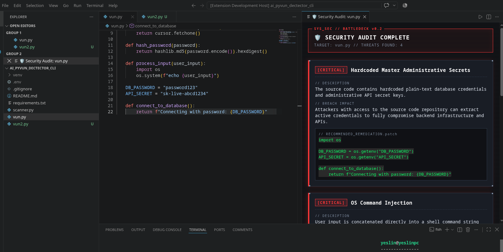

# AI Security Scanner (VS Code extension)

A VS Code extension that scans the Python file you have open for common security flaws, using Google Gemini, and shows the findings with suggested fixes in a side panel.



This is version 2 of my [Python CLI scanner](https://github.com/yessin-ze/ai-security-scanner-cli), rewritten in TypeScript. The build process is written up in the [development log](docs/DEVLOG.md).

## What it detects

- SQL injection
- Command injection
- Hardcoded secrets and credentials
- Weak password hashing (for example MD5)

Each finding includes a description, the possible impact and a suggested fix.

## Severity

The model's own severity labels were inconsistent, so severity is assigned by fixed rules based on the type of flaw:

| Flaw type | Severity |
| --- | --- |
| Command injection, SQL injection | CRITICAL |
| Hardcoded secrets | HIGH |
| Weak hashing | MEDIUM |

These tiers are inspired by CVSS ratings. They are not computed CVSS scores.

## Installation

1. Download `ai-security-scanner-0.0.1.vsix` from the [Releases](../../releases) page.
2. Install it:
   - From a terminal: `code --install-extension ai-security-scanner-0.0.1.vsix`
   - Or in VS Code: open the Extensions view, click the `...` menu, choose **Install from VSIX...** and select the file.

## Setup

You need a Google Gemini API key (you can create one in [Google AI Studio](https://aistudio.google.com/)).

1. Open the Command Palette (`Ctrl+Shift+P`).
2. Run **AI Security Scanner: Set Gemini API Key** and paste your key.

The key is stored in your operating system's keyring through VS Code's SecretStorage API. It is never written to a file in your project.

## Usage

1. Open a Python file.
2. Run **AI Security Scanner: Scan Current Python File** from the Command Palette.
3. The report opens in a panel beside the file.

The scan uses the text in the editor, including unsaved changes.

## Commands

| Command | What it does |
| --- | --- |
| AI Security Scanner: Set Gemini API Key | Stores your Gemini API key in the OS keyring. |
| AI Security Scanner: Scan Current Python File | Scans the active Python file and opens the report panel. |

## Limitations and privacy

- **Your code leaves your machine.** The full contents of the scanned file are sent to the Google Gemini API. Do not scan code you are not allowed to share with a third party.
- **Findings come from an LLM.** It can miss real vulnerabilities and report ones that are not there, so treat the output as a starting point for a review, not a guarantee.
- **Python only.** Other languages are not supported.
- **On demand only.** The extension scans when you run the command. It does not scan automatically while you type.

## Development

```bash
git clone https://github.com/yessin-ze/ai-security-scanner-vscode-extension.git
cd ai-security-scanner-vscode-extension
npm install
```

- Press `F5` in VS Code to launch an Extension Development Host with the extension loaded.
- Build a package with `npx @vscode/vsce package`.

Stack: TypeScript, esbuild, `@google/genai`, the VS Code webview and SecretStorage APIs.

## Roadmap

- Compute real CVSS v3.1 base scores instead of fixed severity tiers.
